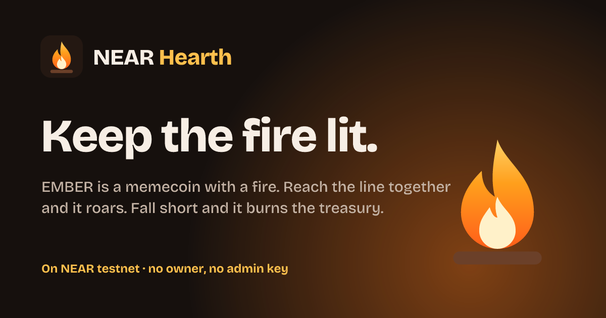
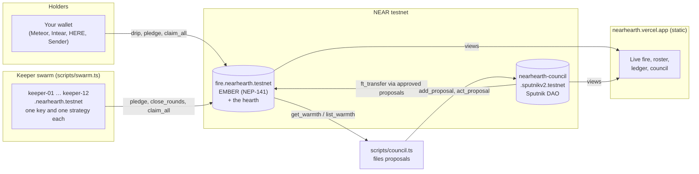
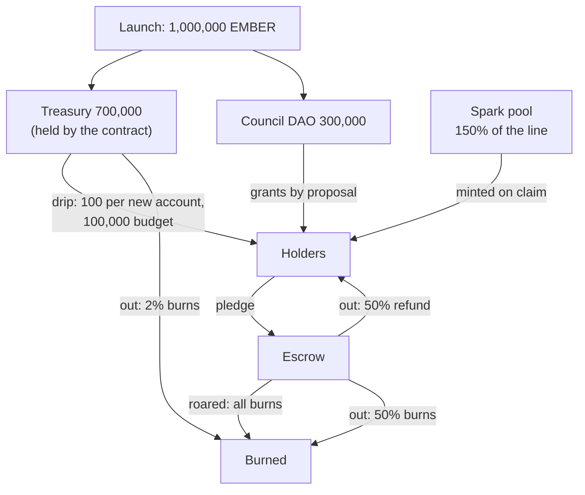

<p align="center">
  
</p>

<p align="center">
  <b>EMBER is a memecoin with a fire. Reach the line together and it roars. Fall short and it burns the treasury.</b><br />
  One NEP-141 contract on NEAR testnet, a swarm of keeper agents, and a Sputnik DAO that pays by reputation.
</p>

<p align="center">
  <a href="https://nearhearth.vercel.app"><b>Live site</b></a> ·
  <a href="RULES.md">RULES.md</a> ·
  <a href="SIMULATION.md">SIMULATION.md</a> ·
  <a href="https://testnet.nearblocks.io/address/fire.nearhearth.testnet">Contract</a> ·
  <a href="https://testnet.nearblocks.io/address/nearhearth-council.sputnikv2.testnet">Council DAO</a> ·
  <a href="docs/TESTING.md">Testing guide</a>
</p>

<p align="center">
  
</p>

---

## The problem

Most memecoins have exactly one mechanic: the price. After launch there is nothing to do but watch it, so nobody comes back. On NEAR you can see it in the numbers. NEAR's memecoin launchpad, meme.cooking, took **$8,807** in fees in November 2024 and **$1.91** in November 2026 so far ([DefiLlama](https://defillama.com/protocol/meme-cooking)). Its volume over the last 30 days was $753 against $550K all time.

A memecoin needs something for its community to *do*, together, that changes the token itself.

## The idea

EMBER has a fire. Every round (10 minutes on testnet; one day on a mainnet launch) holders pledge EMBER to it:

| If the round's pledges… | The fire… | What happens |
|---|---|---|
| reach the **line** | **roars** | Every pledge burns. A spark pool worth **150% of the line** is minted back to the pledgers, pro rata. The streak grows, and the next line rises 10% of the base (up to 3×). |
| fall short | **goes out** | 50% of every pledge burns as ash, the rest is refunded. The streak resets and **2% of the treasury burns**. |
| are zero | is **cold** | Nothing burns; the streak resets. |

It is an assurance game: pledging alone loses, pledging together pays, and because the pool is fixed, pledging far past the line dilutes everyone. The best rounds land right on the line. The streak is the community's high score.

Everything is in one contract with **no owner and no admin method**: the parameters are fixed at launch and readable with `get_params`.

## Check it in 5 minutes

| Do this | You should see |
|---|---|
| Open **https://nearhearth.vercel.app** | The live round: EMBER pledged against the line, the clock, the streak, and a fire that burns brighter as pledges approach the line. Move the cursor through it to fan the embers. |
| Wait, or scroll to **Every round, on chain** | Rounds closing on NEAR testnet with their outcome, burns and sparks, read from `list_rounds` (each closed in a linked block). |
| Open **Keepers** | Twelve agents, each a sub-account of `nearhearth.testnet` with its own key and strategy. Each row shows what it pledged this round and the sentence its strategy would give if it woke now. |
| On **Keepers**, use the simulation tabs | 60 simulated rounds for four communities: a coordinated swarm roars 59 of 60 rounds; take the closers away and it goes out 45 times. |
| Open **Council** | The Sputnik DAO that holds 30% of EMBER, its proposals (proposal #0 funded the keepers and was executed on chain), and the warmth leaderboard it pays by. |
| Connect a testnet wallet on the home page, press **Take your 100 EMBER**, then **Pledge** | A drip from the treasury, then your pledge in the current round; a toast links the transaction on NearBlocks and the fire sparks. After the round closes, **Collect** claims your sparks or refund. |
| `pnpm install && pnpm test` | 10 TypeScript tests pass, including the one that writes the shared vector. |
| `cd contract && cargo test` | 13 contract tests pass, including `agrees_with_the_typescript_rules_engine`, which replays that vector against the contract to the last unit. |
| `pnpm simulate` | Regenerates `SIMULATION.md` and `data/simulation.json` byte for byte (CI checks this). |
| `pnpm status` | The live state of the fire, read from NEAR. |

A full walkthrough, including the wallet path and what each transaction should show on NearBlocks, is in [docs/TESTING.md](docs/TESTING.md).

## How it works



### One round

```mermaid
sequenceDiagram
  autonumber
  participant P as Pledgers (people and keepers)
  participant F as fire.nearhearth.testnet
  participant A as Anyone
  Note over F: Round r opens. line = base × (1 + streak × 10%), capped at 3×
  P->>F: pledge(amount) + 1 yoctoNEAR
  F->>F: EMBER moves into escrow, round total grows
  Note over P: Closers wake late and fill the gap, each up to 25% of the line
  Note over F: Round r ends
  A->>F: close_rounds() (pledge and claim also close)
  alt pledged ≥ line
    F->>F: burn the escrow, spark pool = 150% of line, streak + 1
  else 0 < pledged < line
    F->>F: burn 50% as ash, burn 2% of treasury, streak = 0
  else nobody pledged
    F->>F: cold: streak = 0
  end
  P->>F: claim_all()
  F-->>P: sparks (minted, pro rata) or refund; warmth += pledge if it roared
```

### Supply, by design



Nothing else can create or destroy EMBER.

### The pieces

| Piece | Where | What it does |
|---|---|---|
| Contract | [`contract/src/lib.rs`](contract/src/lib.rs) | EMBER (NEP-141, NEP-145, NEP-148) with the hearth built in: `pledge`, `close_rounds`, `claim`, `claim_all`, `drip`, and views (`get_state`, `get_params`, `get_round`, `list_rounds`, `get_claimable`, `get_accounts`, `get_warmth`, `list_warmth`, `has_dripped`). NEP-297 events for every pledge, close, claim and drip, plus standard `ft_mint` / `ft_burn` events. |
| Rules engine | [`packages/hearth/src/rules.ts`](packages/hearth/src/rules.ts) | The same rules in TypeScript bigint arithmetic, used by the simulation, the site and the tests. |
| Strategies | [`packages/hearth/src/strategies.ts`](packages/hearth/src/strategies.ts) | Every keeper strategy in one readable file. Each decision returns an amount and a one-sentence reason. |
| Simulation | [`packages/hearth/src/sim.ts`](packages/hearth/src/sim.ts) | Deterministic multi-agent simulation (seeded, no chain, no LLM). |
| Swarm runner | [`scripts/swarm.ts`](scripts/swarm.ts) | Plays rounds on testnet: each keeper signs with its own key, wakes at its own time in the round, reads public state and acts. |
| Council | [`scripts/council.ts`](scripts/council.ts) | Files and votes Sputnik DAO proposals from warmth: grants and council membership. |
| Site | [`apps/web`](apps/web) | React 19 + Vite 7, static. Reads the contract and the DAO from the browser; wallets via wallet-selector 10. |

## The keepers

| Keeper | Strategy | What it does |
|---|---|---|
| keeper-01 … 05 | Steady | Throws 10% of the line early in every round. |
| keeper-06, 07 | Skeptic | Waits until 60% of the line is pledged, then adds 5%. |
| keeper-08, 09, 10 | Closer | Wakes in the last 15% of the round and fills the gap, up to 25% of the line each, so three closers can land a gap of 75%. Never over-pledges. |
| keeper-11 | Guardian | When the streak is 3 or more and the fire is about to go out, throws up to 30% of the line at the last moment. |
| keeper-12 | Free rider | Never pledges. Gets no sparks and no warmth: the control group. |

No keeper has any power a human holder lacks. They read the same public state and call the same two methods. The coordination emerges from timing: each closer re-reads the round before acting, so the second closer sees what the first one filled.

## Warmth and the council

Every EMBER an account pledged in a roaring round adds the same amount of **warmth**, credited when it claims. Warmth never decreases and cannot be transferred, and each credit is an event in the claim transaction, so every point traces to a round.

The Hearth Council is a stock Sputnik DAO v2 (`nearhearth-council.sputnikv2.testnet`) holding 300,000 EMBER. We did not write a multisig. `pnpm council warmth` reads warmth from the contract and files two kinds of proposal: the warmest keepers are proposed into the council role, and a grant of 5% of their warmth is paid from the council's EMBER. The DAO's own votes decide.

## Simulation

Before writing the contract we simulated 60 rounds per community under the launch parameters ([SIMULATION.md](SIMULATION.md)):

| Community | Roared | Went out | Best streak | Supply after 60 rounds |
|---|---|---|---|---|
| A coordinated swarm (steady, skeptics, closers, guardian) | 59 | 1 | 57 | +6.15% |
| Nobody closes the gap | 15 | 45 | 2 | −43.04% |
| An overeager crowd (20% of the line each, every round) | 60 | 0 | 60 | −4.78% |
| A fading community (2% fewer keepers each round) | 17 | 41 | 16 | −38.82% |

The first run had steady keepers at 8% and closers that would only fill a gap under 40%: the swarm never roared. We changed the strategies, not the rules, until coordination worked, and kept the result in the history.

## What is real

| | Status |
|---|---|
| Contract | `fire.nearhearth.testnet`, deployed with `new` in [D2qfHZv1…](https://testnet.nearblocks.io/txns/D2qfHZv1gb1tj7sJZNCsgot2cmxTWbkfrjMhapxVGGvd). Code upgraded twice to add read-only views, state kept ([BKCq1y8C…](https://testnet.nearblocks.io/txns/BKCq1y8CKV1CdaPc9Jd6msLNiS5EcC64BemxH8Wa9DNa), [CqEArwpe…](https://testnet.nearblocks.io/txns/CqEArwpeGihQR1hJtbKjqDQ6EWxg9QNphwPgy3hGMjbx)). |
| Council | Sputnik DAO created by the official testnet factory in [D82wLv3u…](https://testnet.nearblocks.io/txns/D82wLv3u1Q4VB2Qipm3DwLeZZ9S96gZAxc762W8wL14h). Proposal #0, 2,400 EMBER to each of 11 working keepers in one `FunctionCall` proposal: filed in [BEUpeFA6…](https://testnet.nearblocks.io/txns/BEUpeFA6tvjuaKaE6jDymVAJMzxowe18gZSrzfQEmKGg), approved and executed in [FSQ8Y8FZ…](https://testnet.nearblocks.io/txns/FSQ8Y8FZLCbBryWquRpWRku8QWavQbbWfihcFHQswtBL). |
| Keepers | 12 sub-accounts of `nearhearth.testnet`, each with its own key. Round 1 roared with the swarm alone: the steady keepers' first pledge was [CV2aYxmc…](https://testnet.nearblocks.io/txns/CV2aYxmc52QNc16a2fv6dECV3fqtQyNKmmuiMyRTKuKh), and closer keeper-09 claimed 375 EMBER of sparks in [2YWG5nCa…](https://testnet.nearblocks.io/txns/2YWG5nCaGaZLgVdkYoGaPb4pf3y3VkZ5aBEeHq6bC1iJ). |
| Site | https://nearhearth.vercel.app, fully static; every number on it is read from the chain in your browser. |
| Mainnet | Not deployed. Test tokens only. |

## Use cases

- **Memecoin communities** get a ritual with stakes: show up each round, land the line, protect the streak. The token's supply records how well the community coordinated.
- **Launchpads** (meme.cooking and others) can offer a "hearth" as a launch option: the mechanic is one contract with fixed parameters and no owner, so a launch cannot be rugged through it.
- **DAOs** reward contributors by provable, non-transferable participation (warmth) instead of token balance, and pay through their existing Sputnik DAO.
- **Agent builders** get a small, real economy to test coordination strategies in: public state, a clear payoff, and a scoreboard (the swarm runner is ~100 lines).
- **Researchers** get a live assurance game with on-chain outcomes, and a simulator that reproduces it.

## NEAR tracks it fits

| Track | Why |
|---|---|
| Memecoins With Mechanics | The mechanic is the token: supply reacts to the community each round; treasury with rules; an on-chain ritual and a high score. Parameters fixed at launch, no admin key, NEP-141, simulated over 60 rounds before launch, sybil limits stated (RULES.md). |
| AI Swarms | A coordination market among agents on sub-accounts of one parent, with conditional pledges settled by the contract (pledge only pays if the group lands the line). Simulation mode runs without any LLM; the live page shows rounds, pledges and who got what. |
| Social Money | Collective ownership and programmable rewards on top of an existing Sputnik DAO: the council holds 30% of supply and pays by warmth, a reputation every point of which traces to a finished round. No new multisig. |
| Games With Real Economies | The economy is the gameplay: keep the fire lit, with NPC keepers that hold wallets and inventories, act on readable rules, and change the economy round by round without a dev patch. |
| Open Innovation | An assurance-game memecoin: a token whose supply is a record of how well its community coordinated. |

## Repository layout

```
contract/            The hearth: EMBER + game, Rust, near-sdk 5.29. 13 unit tests.
packages/hearth/     Rules engine, keeper strategies, simulation, chain helpers. 10 tests.
apps/web/            The site (React 19, Vite 7, wallet-selector 10).
scripts/             swarm, council, simulate, status, setup-keepers, deploy.
data/                simulation.json and the swarm's log of every decision.
RULES.md             The rules, written before the contract.
SIMULATION.md        Generated by pnpm simulate.
docs/                TESTING.md, SECURITY.md, AUDIT.md, DEPLOYMENT.md.
brand/               Logo, mark, square and banner images.
```

## Commands

Node 22+, pnpm 10, Rust (for the contract).

```bash
pnpm install
pnpm test                    # rules engine, strategies, simulation, shared vector
pnpm simulate                # 60 rounds × 4 communities → SIMULATION.md
pnpm status                  # the fire, read from NEAR testnet
pnpm swarm --rounds 6        # play six rounds with the keeper swarm (keeper keys needed)
pnpm council list            # the council's proposals
pnpm council warmth          # propose the warmest keepers into the council and a warmth grant
pnpm dev                     # the site on http://localhost:5175
cd contract && cargo test    # 13 contract tests
```

## Security

No owner and no admin method in the contract; escrow tracked apart from the treasury; 256-bit `mul_div` for payouts; force-unregister disabled; one-yocto confirmation on pledges. The contract account still has a deploy key, used only to add views; a mainnet launch would remove it. Details and limits: [docs/SECURITY.md](docs/SECURITY.md).

## Built with

near-sdk-rs 5.29 and near-contract-standards, near-api-js, @near-wallet-selector 10, Sputnik DAO v2 (the official testnet factory), React, Vite, Vitest, Biome. Data on the problem: DefiLlama. AI assistance: written with Claude.

## License

MIT. See [LICENSE](LICENSE).
