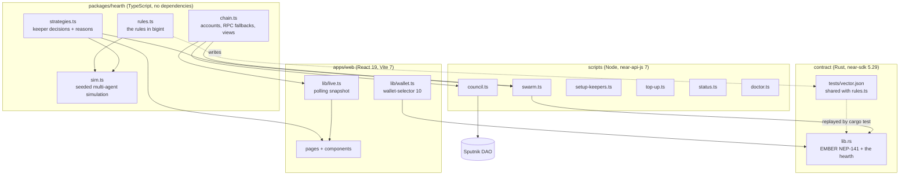

# Architecture

## Boundaries

- **The contract is the source of truth.** Nothing off chain can change an outcome. Scripts and the site only read state and send the same calls a holder could.
- **`packages/hearth` has no runtime dependencies** and runs in Node and the browser. The site, the scripts and the tests all import the same rules and strategies.
- **Reads are batched.** The site's full refresh is about six RPC calls (`get_state`, `list_rounds`, `list_warmth`, `get_accounts` for the whole swarm, and two DAO views); between refreshes it polls `get_state` only.
- **Writes are retried only on rate limits.** A 429 means the transaction was not accepted, so `scripts/lib/signer.ts` tries the next RPC; any other error is reported, never retried blindly.

## Data flow of one round

1. Keepers (and people) call `pledge`; the contract moves EMBER to escrow.
2. After the round ends, the first `close_rounds`, `pledge` or `claim` settles it: burns, a round record, events.
3. Pledgers call `claim_all`; sparks are minted (roared) or refunds paid (out), and warmth is credited.
4. The site sees the new round in its next poll and throws sparks if it roared.
